## From the dry-run to the real thing

The [last post](/posts/peas-soc-attacking-our-own-detection-matrix/) was a rehearsal. Before our group's graded attack/defence rounds, I ran three untested rows of the detection matrix solo — attacker and analyst at once — and came back with three results: SSH brute force **detected**, the vsftpd 2.3.4 backdoor a **confirmed, total gap**, and UNION-based SQL injection **detected**. The point of doing it early was to fix what was broken before it cost us marks in front of a teacher.

This post is what happened when it counted. All four rounds ran live on the night of **10 November**, 6:30–9pm, in class — red team versus blue team, four rounds, fixed roles per round, every action logged as it happened rather than reconstructed after. I was attack lead across the night and took a defender seat in three of the four rounds, attacker in Round 3. Two of the dry-run findings fed fixes that held up live. One rule I *thought* was fixed turned out to have a blind spot I only found by running it for real — which is the best thing that happened all night, and the part I'd have missed entirely if I'd trusted the dry-run and stopped there.

## The network, and the AD box in full

Here's the logical design the rounds ran on — nine zones behind one pfSense firewall, KaliRed on the GUEST segment (VLAN 40) as the only platform attacks come from, the DMZ (VLAN 30) holding the targets, and the SOC (VLAN 20) watching.

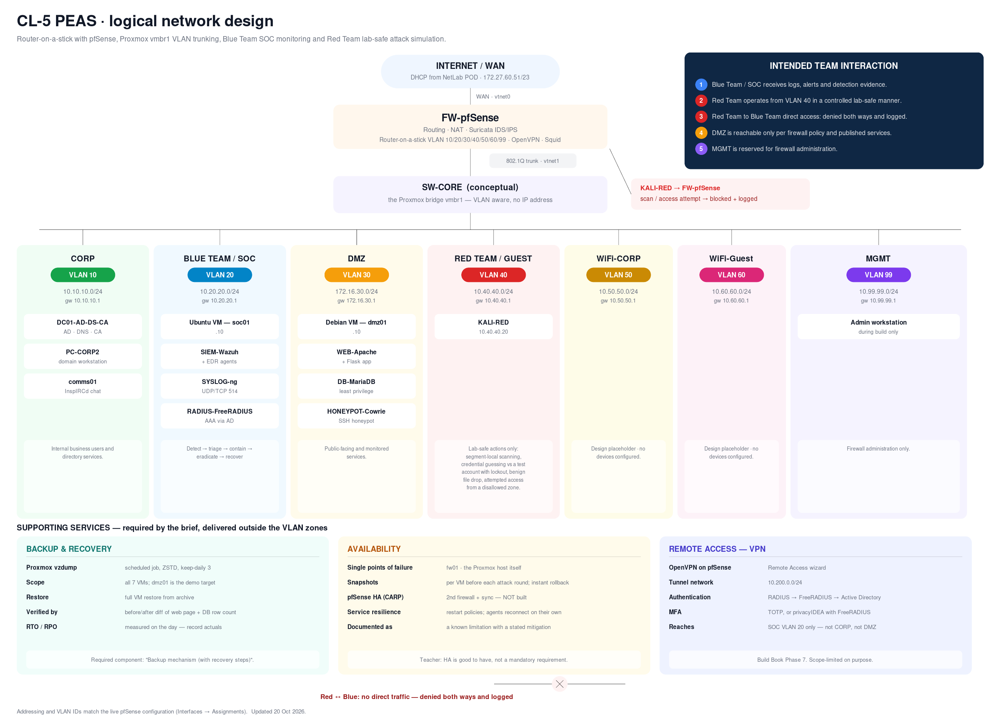

The one box that diagram flattens is `DC01` — it reads "AD · DNS · CA" and leaves it there. That box did a lot of work, so here it is in full:

> **DC01 — the domain controller, in full**
>
> **Domain:** `peas.local` (NetBIOS `PEASDC1`), with `DC01.peas.local` holding the PDC, RID and Infrastructure master FSMO roles.
>
> **Enterprise Root CA:** `peas-DC01-CA` (`CN=peas-DC01-CA,DC=peas,DC=local`), RSA 2048 / SHA256, issuing DC01's own server certificate.
>
> **LDAPS:** verified end-to-end on port 636 — TLS 1.3, `TLS_AES_256_GCM_SHA384` — from SOC01 to DC01, with an authenticated bind confirmed via `ldapsearch`.
>
> **RADIUS:** FreeRADIUS 3.2.5 with `freeradius-ldap` on SOC01, backing VPN authentication for the `VPN-Users` group against AD.
>
> **Kerberos:** ticket issuance independently verified by packet capture — `kinit`/`kvno` with `tshark`, capturing both the AS and TGS exchanges.
{.callout}

Everything else on the diagram — the VLANs, the other VMs, the router-on-a-stick trunk — is unchanged from the build.

## Round 1 — Reconnaissance (one miss by design, then detected)

Adam ran Round 1; I was on the blue side. The point of the round was host and service discovery across the DMZ from KaliRed (10.40.40.50).

The first scan, at 19:09, was a pure ICMP host-discovery sweep — `nmap -sn -PE -PP` against the DMZ /24. It wasn't detected, and that's correct, not a failure: it's ICMP echo only, no TCP, and our ruleset keys on TCP-scan patterns. There's nothing there for the signatures to catch. Worth stating plainly rather than quietly hoping nobody asks why the first scan went dark.

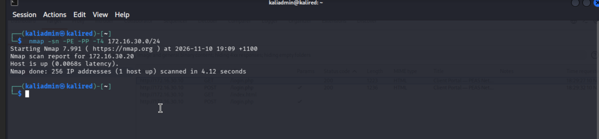

The follow-up at 19:11 and 19:13 was the service/version scan (`-sC`/`-sV`), and the moment it touched TCP it lit up: Suricata fired **ET SCAN Nmap Scripting Engine User-Agent Detected**, repeated hits on `DebianDMZ:80`, on the Wazuh dashboard by 19:20.

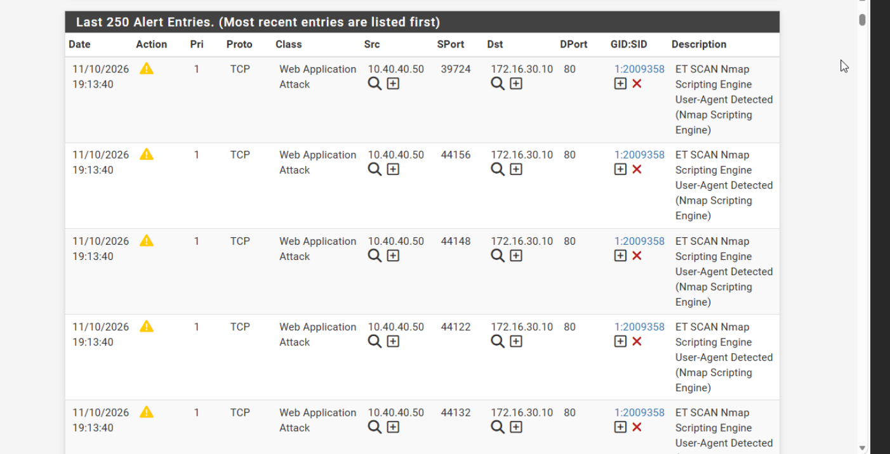

One honest footnote from this round: a second Suricata signature — **TLS invalid record type / Applayer Mismatch** — also fired, on TCP/21 traffic to Metasploitable. That's not a scan-detection signature doing its job; it's protocol-anomaly noise from the `-sV` probe speaking not-TLS at an FTP port. I logged it as what it is rather than counting it as a second detection win.

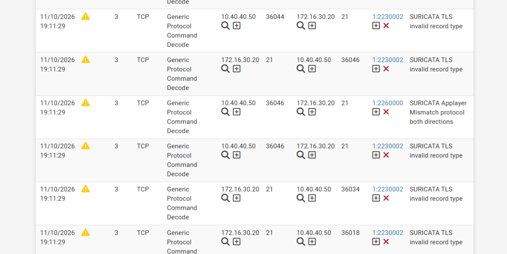

## Round 2 — Credentials, and the vsftpd gap I'd closed since last time

Armando attacked Round 2. Two parts: a Hydra brute force, then the vsftpd backdoor — the exact gap from the dry-run post.

Hydra recovered valid SSH credentials on two targets within the round: `msfadmin` on Metasploitable (172.16.30.20) at 19:37, and a weak `webadmin` account on DebianDMZ (172.16.30.10) at 19:38. Both showed up on the blue side as **Wazuh rule 86601** for repeated SSH connection attempts.

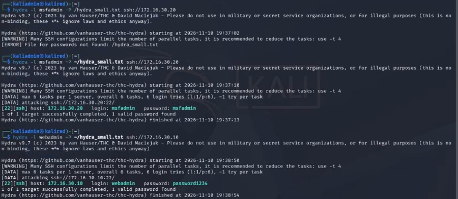

Then the part I actually wanted to see. In the dry-run, the vsftpd 2.3.4 backdoor was a *total* blind spot — I searched Wazuh for any hit on port 21 or 6200 and got nothing. Between the two posts I wrote a pair of custom Suricata rules specifically to close that gap. Round 2 was the live re-test.

The backdoor still triggers exactly as before — port 6200 refuses the first connection (not yet armed), the `USER backdoored:)` string goes in over port 21 to arm it, and a reconnect to 6200 drops an unauthenticated root shell:

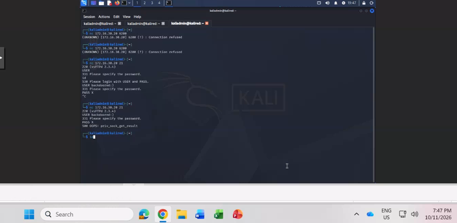

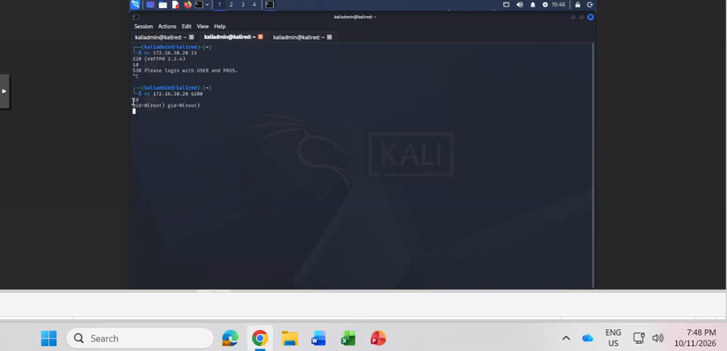

But this time it did not go dark. The two custom rules fired: **sid 1000010** on the backdoor trigger string, **sid 1000011** on the port 6200 shell connection. That's the specific thing the dry-run post said we didn't have — here's the gap from last time, here's the rule I built to close it, here it is firing live under a graded round.

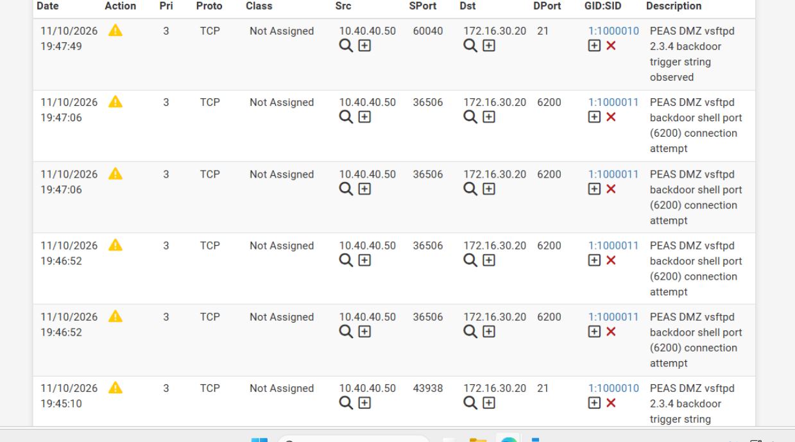

The honest "what didn't" for this round: the initial Metasploit module didn't establish a Meterpreter session. The backdoor itself was confirmed root-level the manual way, over a raw connection to 6200, which is what the evidence above shows.

## Round 3 — SQL injection, and the rule gap I found under fire

I ran Round 3 as attacker, against `login.php` on DebianDMZ. This is the one I'd tell you about if you only had time for one.

The boolean-based auth bypass logged straight in as `alice` with no valid password, via Burp:

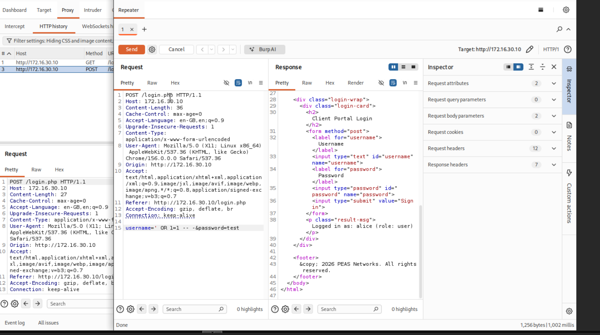

Here's the problem, and it's a good one. We had a custom rule (**sid 1000012**) for the boolean bypass. It matched the *unquoted* form of the payload — `1=1`. The payload that actually logged me in used the *quoted* form — `'1'='1'` — and the rule didn't match it at all. So the bypass that worked sailed straight past the detection I'd written for exactly that attack. Not a theoretical gap, not a pre-round assumption — I watched it happen mid-round, as the attacker, against my own rule.

So I fixed it live: diagnosed the miss, added a second rule (**sid 1000013**) covering the quoted-form variant, and re-confirmed detection before the round ended — including re-checking that sid 1000012 still fired correctly on the unquoted form it was always meant for. The alert below is 1000012 on the unquoted form, which was never the problem; the quoted form was, and 1000013 is what now covers it.

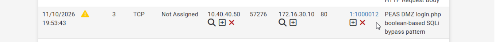

With that closed, the UNION-based extraction chain ran and was detected every time, ~1 second each. At 19:58 a UNION pull from `internal_notes` surfaced a staff reminder about changing a default password, referencing open ticket **SOC-114**:

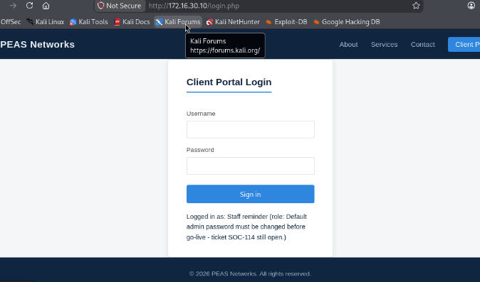

Each UNION request tripped **sid 2053468** (ET WEB_SERVER Possible SQL Injection UNION SELECT in HTTP Request Body) on the DMZ:

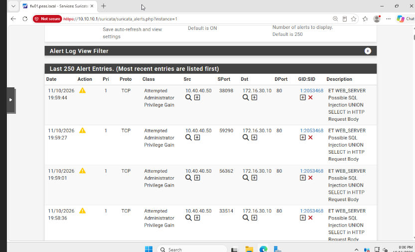

The round ended at 20:01. The after-action note for it is one line I'm proud of: the one thing that didn't work is the thing that made the round worth running — the quote-form gap was real, and only live testing exposed it.

## Round 4 — SYN flood and blocking (what actually triggered the block)

Round 4 was the only round with automatic blocking switched on — a team-lead decision I reconfirmed on the day, after separately verifying the blocking mechanism worked at GUI, pf-table and engine-log level ahead of time. Sattari attacked; I was defending. The planned test case was a single timed, single-source SYN flood.

It ran in two steps. A connectivity ping first — one reply, then 88.9% loss — and then `sudo hping3 -S --flood -p 80`, which pushed 602,732 SYN packets with zero replies:

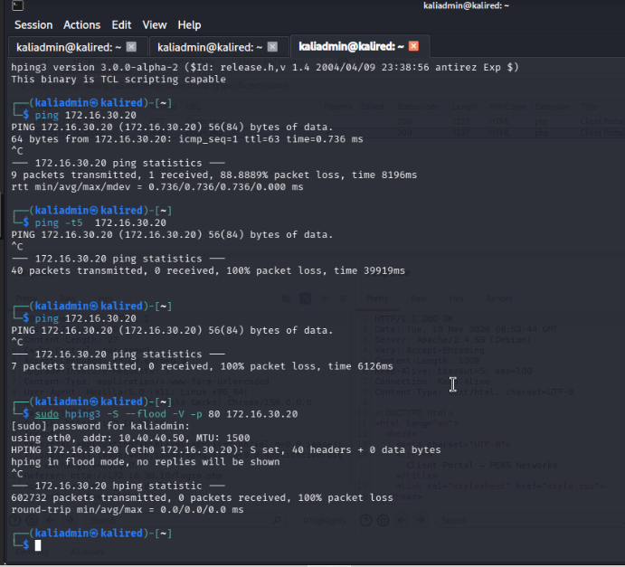

Here's the counter-intuitive, honest finding. The automatic block *did* land on KaliRed (10.40.40.50) within the round — but it wasn't a SYN-flood signature that triggered it. It was **GPL ICMP PING \*NIX (sid 2100366)**, firing on the *preliminary connectivity ping*, that tripped the block at 20:03:

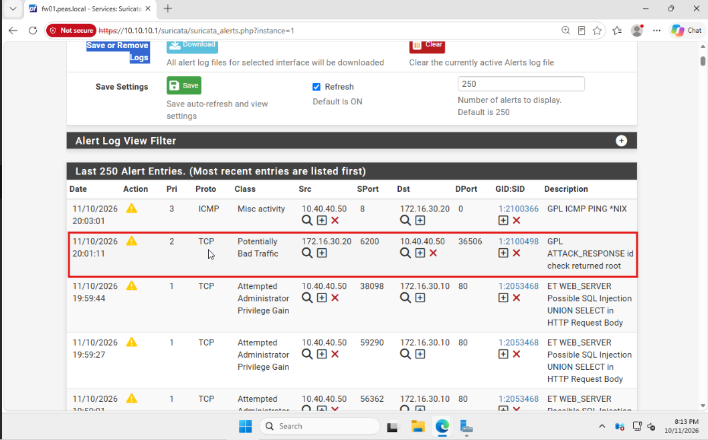

By the time the `hping3` flood actually ran, KaliRed's own source IP was already blocked at the firewall. So the flood's 100% packet loss reflects that existing block — it is **not** proof that a dedicated SYN-flood signature (the 2210004/2210007/2210008 family we'd planned around) fired independently. The Blocks page confirms KaliRed blocked; it doesn't confirm *why* in the way the round was designed to show.

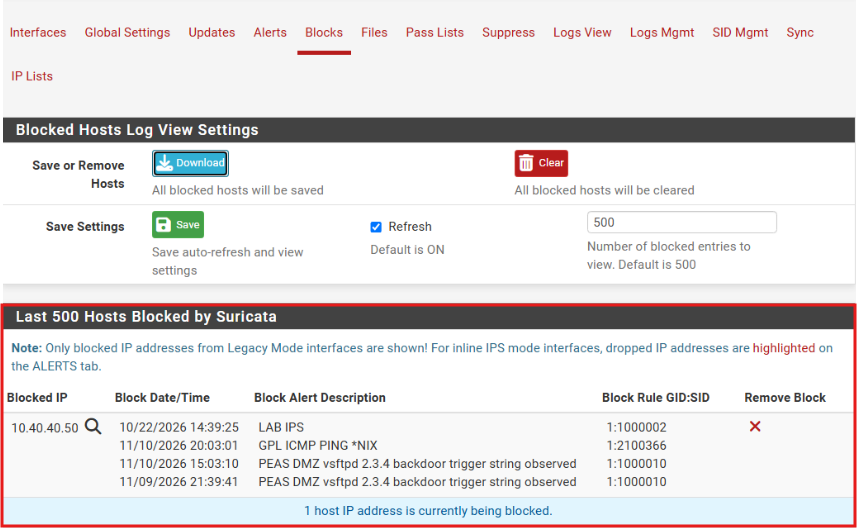

The genuine win here isn't "we detected a SYN flood" — it's that blocking worked and landed fast. During pre-round testing on 9–10 November there was an undocumented multi-minute delay between an alert firing and the block landing; on the night it landed within the round. That's the result worth keeping. The flood-signature question is written down as what it is: unproven this round.

## After the rounds: a System State backup on the DC

The brief wanted a backup mechanism with recovery steps, and I'd left System State backup on the domain controller as a stretch goal. I did it on **11–12 November**, after the rounds, and it came with a couple of real-world snags worth recording.

First, System State can't write its backup to the volume it's backing up, so DC01 needed a separate target disk. I added a second virtual disk in Proxmox and brought it online in Windows:

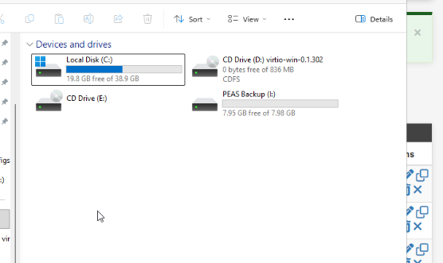

Then the Windows Server Backup feature, and `wbadmin start systemstatebackup` against the new drive:

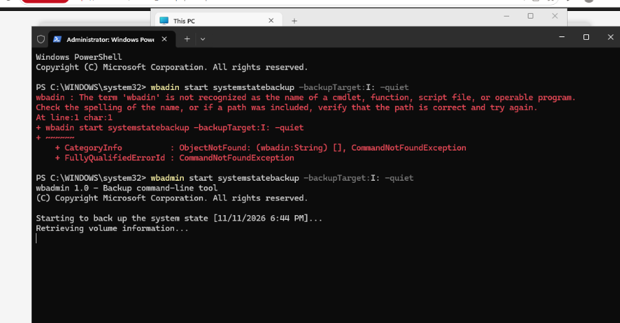

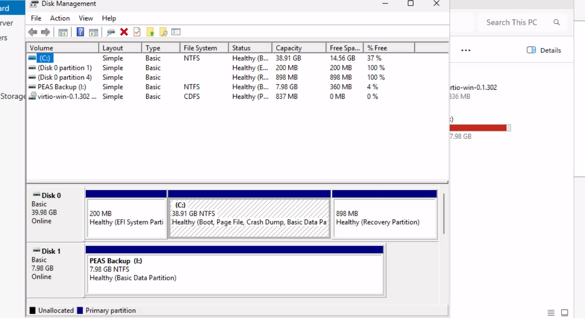

The snag that didn't get edited out: NetLab sessions are time-limited, and the backup didn't finish inside one. It got cut off, and I had to resume it from home the next day to let it complete — exactly the kind of constraint you hit on shared lab infrastructure and plan around rather than pretend away.

It did complete, and `wbadmin get versions` is the proof it's recoverable — a dated version on the target drive, recoverable at volume, file and application level:

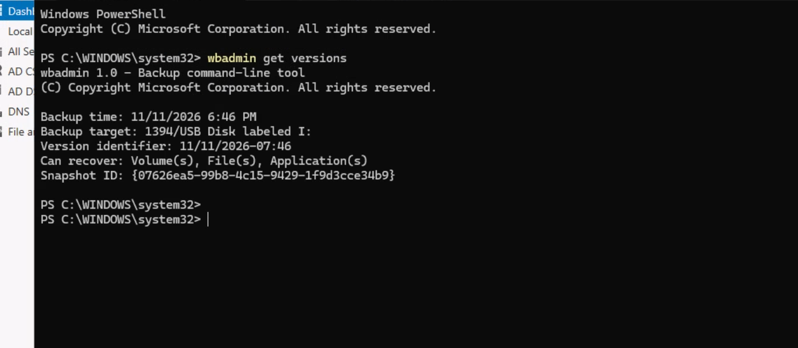

## A detection health check before the demo

Before the teacher's live walkthrough, I ran a quick health check to make sure nothing had regressed since the rounds — the kind of thing that's cheap to do and embarrassing to skip.

The custom Suricata rules (1000010–1000013, the vsftpd and SQLi coverage built across both posts) were confirmed loaded:

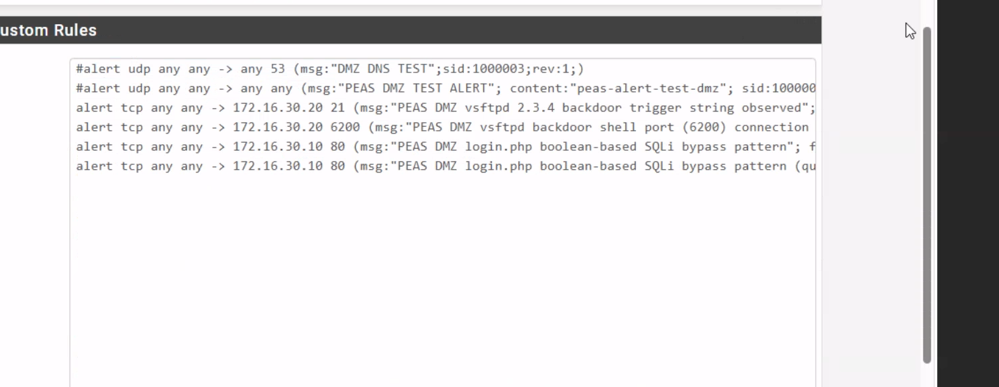

And the Round 4 block still reproduces end to end — the pfSense firewall log shows the ICMP block, and Wazuh correlates the same pfSense block event, so the detection path from firewall to SIEM is intact:

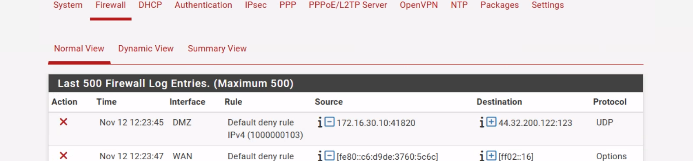

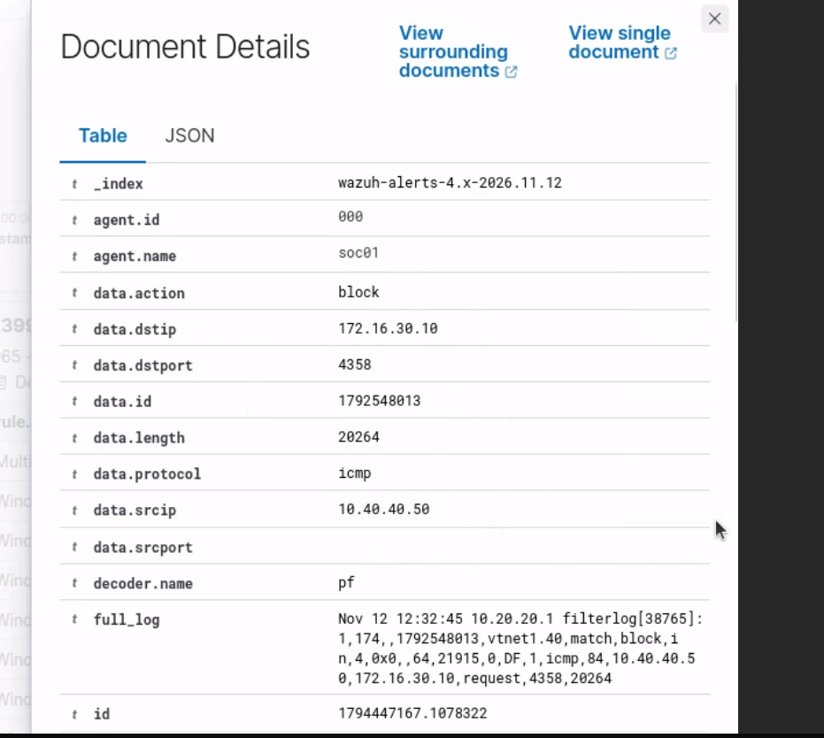

## Where this leaves the project

Three findings came out of the solo dry-run. Two of them turned into fixes that held up live: the vsftpd backdoor went from a total blind spot to two custom rules (1000010/1000011) firing under a graded round, and the SQLi detection I'd built was in place and catching the UNION chain. SSH brute force, detected in the dry-run, was detected again live.

But the thing I'm actually taking away is the one problem the dry-run *didn't* find — the boolean rule's quote-form blind spot — because only running it live, as the attacker, against my own detection, exposed it. A dry-run tells you whether the thing you thought to test works. Going live tells you about the thing you didn't think to test. "Everything worked" would have been a weaker project than this: two fixes proven under fire, one gap I'd never have found if I'd trusted the rehearsal and stopped.
