


PEAS SOC is a nine-zone enterprise network I designed and built from scratch
in a Proxmox lab environment for a TAFE group project (CL5, "Build and
Battle"), then led the live attack-and-defence exercise against. As team
lead, I coordinated the planning, built the core infrastructure, and ran
blue-team detection across the exercise.

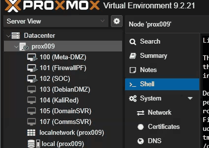

This page covers the whole project end to end: the design decisions before
a single VM was built, the network itself, what got attacked and defended
across four live rounds, the troubleshooting that didn't make it into any
polished report, and what came out of it. It deliberately leaves out
configuration detail (firewall rule syntax, exact RADIUS config, etc.) —
that lives in the project's own playbook and report documents, not here.



Before any build work, the group worked through the network's zone design
and threat model together: which segments a real business would realistically
need — a corporate LAN, a dedicated SOC analyst segment, a public-facing DMZ,
guest wifi, and a locked-down management plane — and, just as importantly,
which of those should never be allowed to talk to each other directly. That
"never talk directly" list became the project's actual security requirement,
not an afterthought bolted on after the network was built.

Segmentation was designed around aliases, not one-off rules, so the deny
policy could be reasoned about and audited as a whole rather than as a pile
of individual firewall entries:

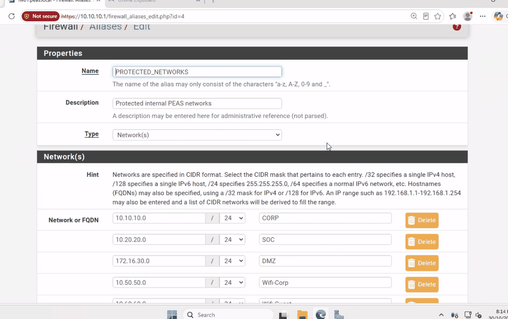

Role and round planning were revisited mid-project too. The group initially
scoped a five-round attack/defence exercise with rotating attacker/defender
roles each round. Once the blue/red split was finalised, we deliberately cut
this back to four rounds with **fixed roles**, each targeting a different
stage of the kill chain — a scoping decision made to keep the exercise
focused rather than repetitive, and to give red team more depth per round
instead of breadth. Fixed roles also meant blue team built up real
familiarity with "their" segment of the network across all four rounds,
instead of starting cold each time.



pfSense sits at the centre as firewall and router, segmenting nine zones:
WAN, LAN, CORP, SOC, DMZ, GUEST, WIFICORP, WIFIGUEST, and a locked-down MGMT
plane reserved purely for firewall administration. Explicit deny rules
enforce isolation between zones that should never touch (GUEST can never
reach SOC or MGMT), and every block is logged.

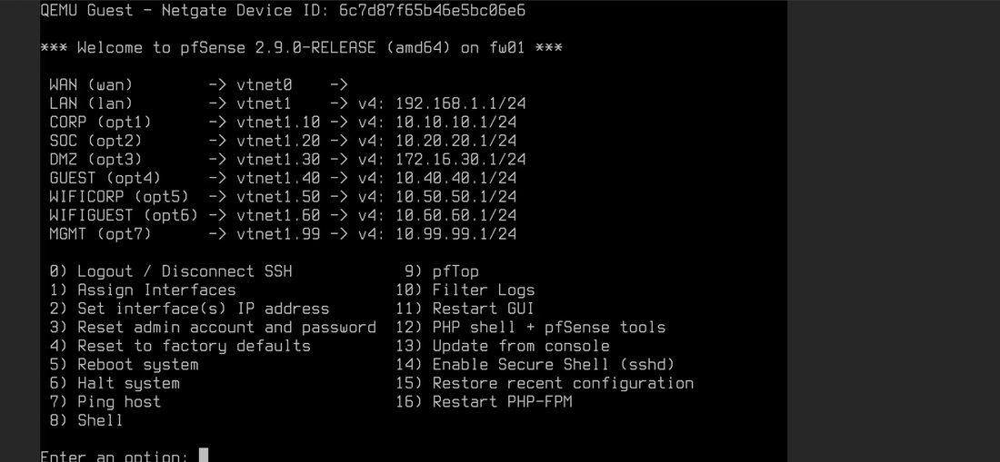

DHCP on each zone uses a mix of dynamic leases and static mappings, so
known infrastructure (the SOC tooling, the DMZ target) always comes up on
a predictable address instead of drifting:

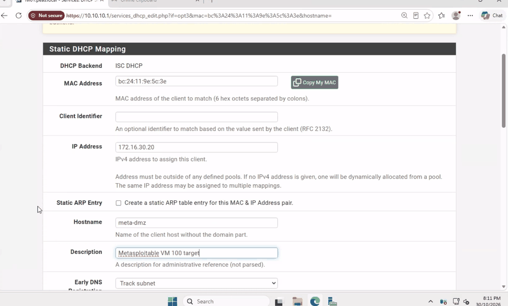

Remote access runs through OpenVPN with FreeRADIUS authentication, where
RADIUS **group membership** — not just a valid login — determines which
internal segments a VPN client can actually reach. This was proven live:
one RADIUS group correctly reached CORP while being refused DMZ and SOC;
a second group was correctly refused entirely.

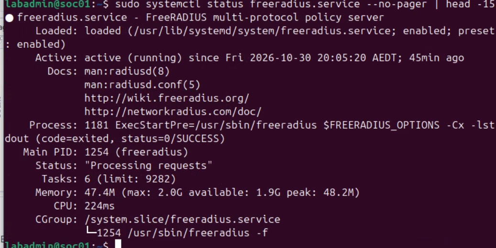

Getting there wasn't a one-shot config: RADIUS authentication initially
failed outright with no response from the server at all —

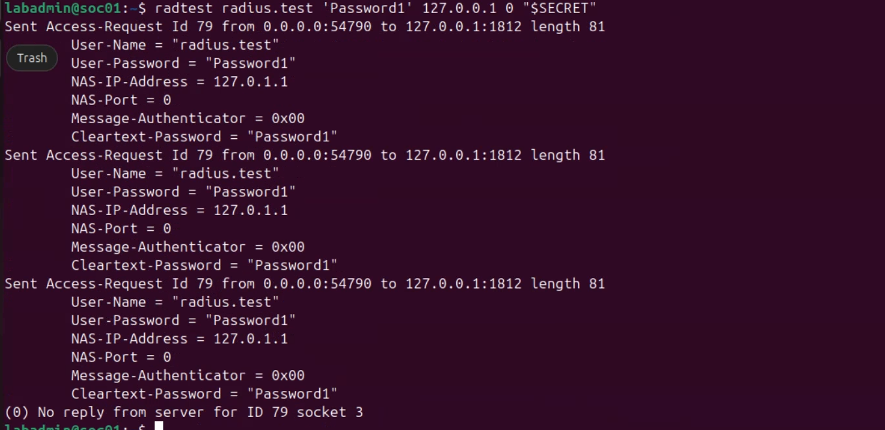

— traced back through the LDAP bind chain and fixed, confirmed by the same
test now correctly accepting a valid password and rejecting an invalid one:

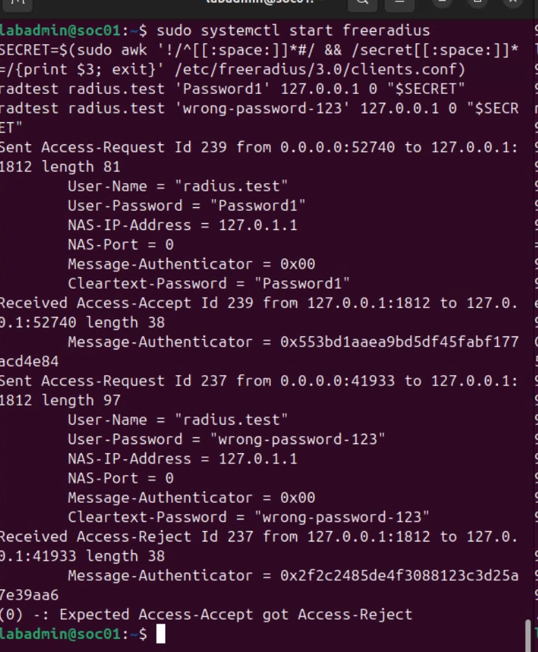



- A Metasploitable-based target VM (VM 100) with a clean-baseline snapshot
  workflow, rolled back between rounds so every exercise starts from a
  known, identical state.
- A custom DMZ web application (PHP + MariaDB) deliberately built with a SQL
  injection flaw, later expanded with additional database tables to support
  a full UNION-based extraction chain rather than a single canned exploit —
  giving red team column-count discovery, padding technique, and multiple
  targets of different shapes to work through.
- Suricata IDS deployed across GUEST, DMZ and CORP, run in detection-only
  mode for the first three rounds, with round four dedicated purely to
  validating blocking behaviour.
- A full backup and disaster-recovery workflow for the firewall, including a
  genuinely off-host backup and a timed restore-and-boot test to produce
  real, measured recovery figures rather than estimates (~2 min 10 sec
  measured RTO, well inside the 1-hour target).

Isolation itself was built and proven incrementally, not assumed: the GUEST
zone's rule set was explicitly tightened to deny reach into the protected
internal networks, verified by comparing the rule set before and after the
change took effect —

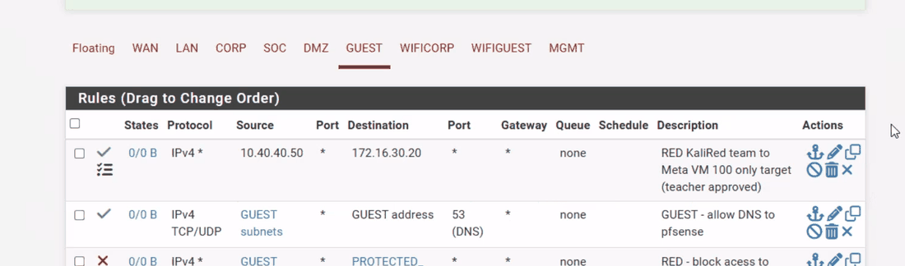



The live exercise ran as four fixed-role rounds, each with its own focus:

| Round | Focus | Defenders | Attackers |
|---|---|---|---|
| 1 | Reconnaissance & enumeration — Nmap scan, service/version scan | Fixed blue team | Fixed red team |
| 2 | Credential & service exploitation — brute force, FTP backdoor trigger | Fixed blue team | Fixed red team |
| 3 | Web application SQL injection — boolean bypass + UNION-based extraction chain | Fixed blue team | Fixed red team |
| 4 | Blocking-mode validation — Suricata blocking enabled, SYN flood test case | Fixed blue team | Fixed red team |

**Round 1 — Reconnaissance.** Nmap scripting-engine scan detected and
correctly attributed:

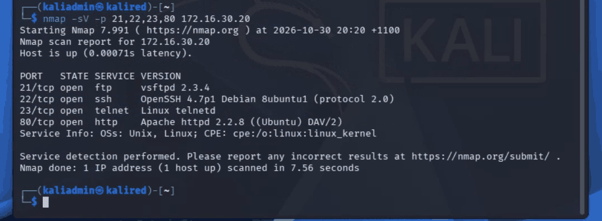

**Round 2 — Cross-zone attack attempt and zone isolation.** Red team
(Kali, on GUEST) attempted to reach a protected internal host directly:

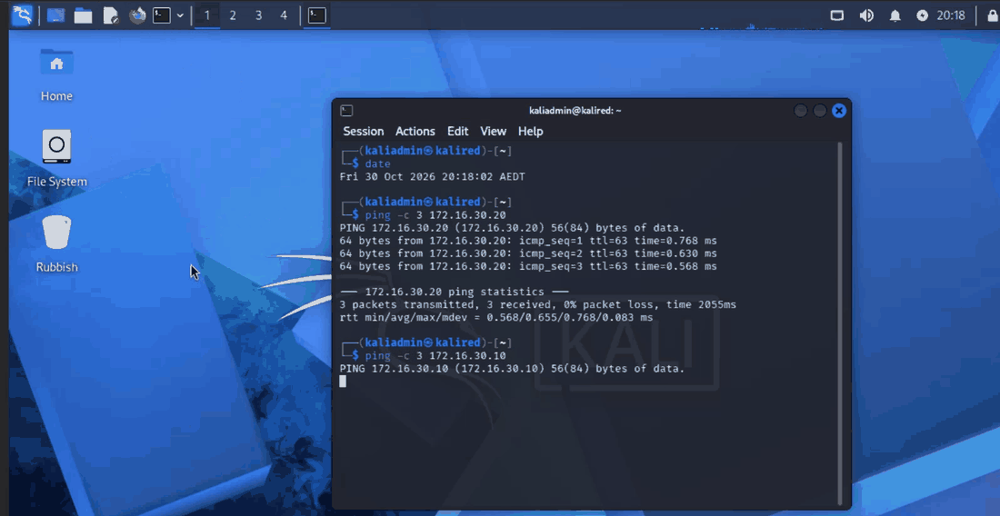

...and was explicitly blocked and logged by the firewall rather than
silently dropped, with the rule name and timestamp captured as evidence:

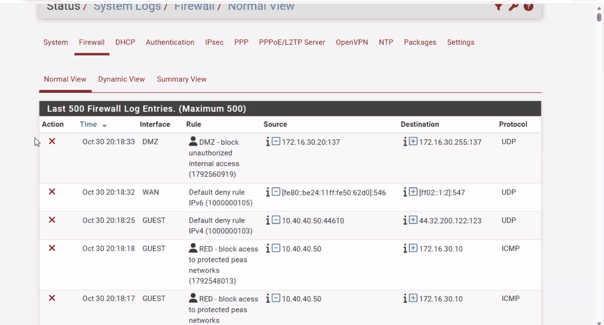

The same isolation behaviour, shown from the other side of the log:

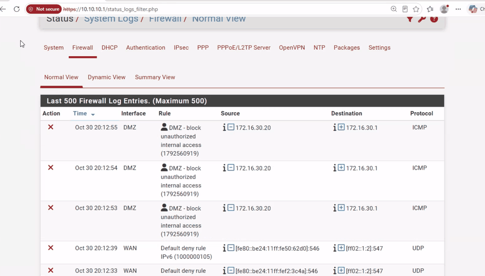

Suricata alerting on the DMZ segment during the exercise:

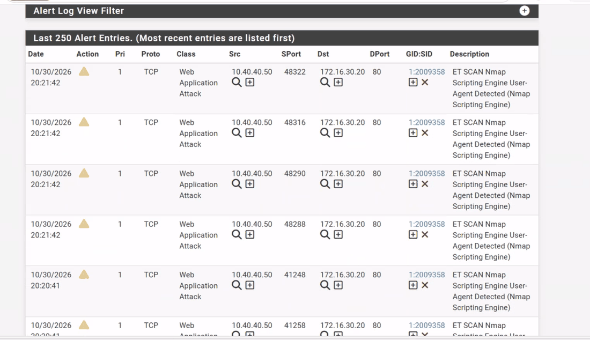

...correlated against Wazuh for a second, independent view of the same
activity:

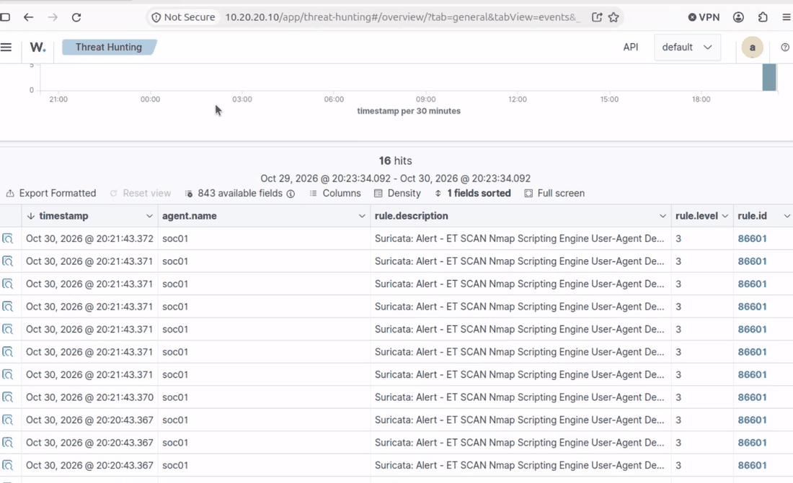

Between every round, VM 100 is rolled back to its clean baseline so each
round starts identical:

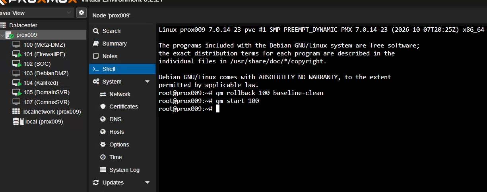

**Round 3 — SQL injection.** The baseline, confirmed working before any
injection attempt:

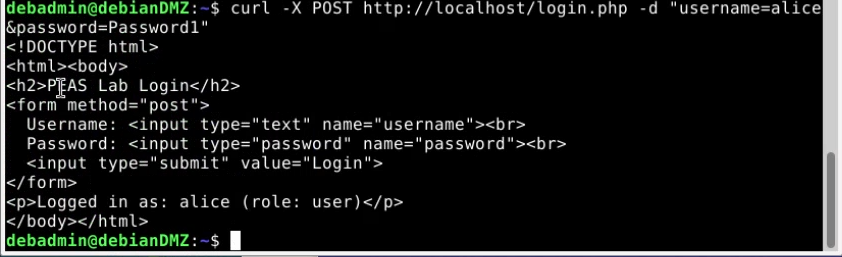

A genuine detection gap was found here and documented rather than hidden:
the generic Suricata ruleset did not alert on a boolean-based SQL injection
payload at all — it was caught only via the database's own query log. The
SQL injection surface was later deliberately expanded beyond the single
boolean bypass into a full UNION-based extraction chain across three
differently-shaped database tables, giving red team column-count
discovery and NULL-padding technique to work through, not just one
canned payload.

While reviewing the app's own setup for that work, a separate, genuine
finding turned up: a stale reverse-proxy configuration routing requests to
a service that no longer matched the current deployment —

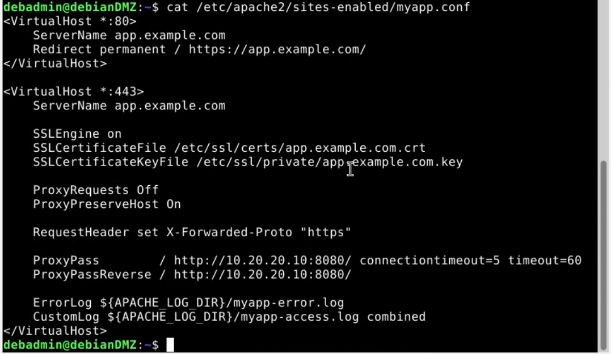

That gap, and the incident-response steps the blue team documented for it
(detect, contain, eradicate, recover, lessons learned), fed directly into
the project's blue-team playbook as a reference for future rounds.

**Round 4 — Blocking-mode validation.** Suricata's detection tooling,
used throughout the exercise to pull logs per-instance for correlation:

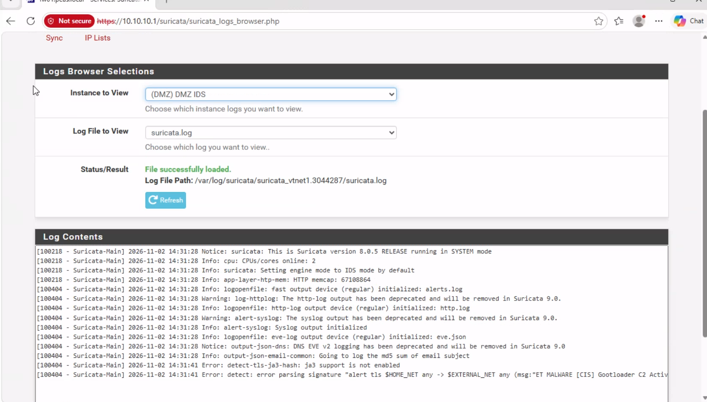



Real infrastructure means real problems, found and fixed rather than
designed away:

- A campus WAN outage knocked out DHCP mid-project and had to be isolated
  and escalated before VPN testing could continue.
- VPN authentication failures needed careful isolation between genuine
  backend/config issues and simple operator error — both occurred, and both
  had to be distinguished before either could be called "fixed." The
  RADIUS no-reply/fixed pair on Page 3 was one strand of that work; the LDAP
  bind chain behind it took several more passes before it held up to a
  repeated test, not just a lucky first pass.
- A detection-pipeline gap between SOC's log forwarding and Wazuh was found,
  corrected, and then validated by forcing a fresh alert through end-to-end:

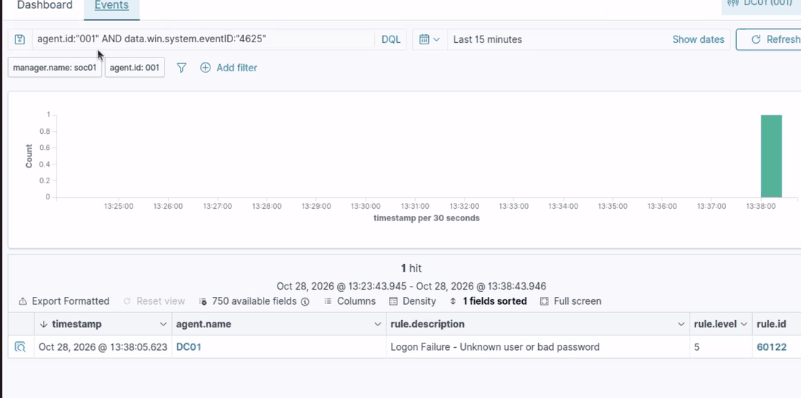

- Elsewhere in the same log-pipeline work, a domain controller's clock had
  drifted out of sync with the rest of the environment, quietly breaking
  Kerberos and skewing event timestamps across the SOC's correlated view
  until it was corrected:

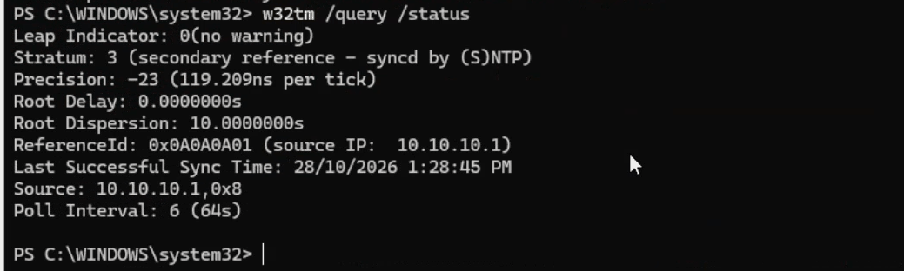

- A SOC log listener that had silently stopped was found and brought back
  up under a fresh process, then confirmed receiving events again before
  being signed off as resolved:

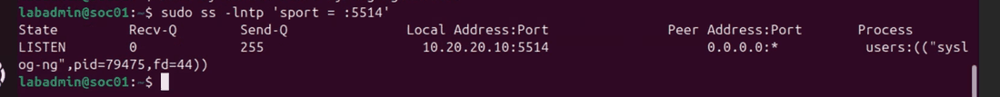

- A shared lab host with SSH root login centrally locked down by policy
  needed a clean, self-removing workaround to get a backup archive
  genuinely off the host — rather than weakening the host's own security
  controls to make the job easier.

Each of these was a case of distinguishing "looks broken" from "is actually
broken, and why" before calling anything fixed — the no-reply RADIUS test,
the stale reverse-proxy config, and the quiet log listener all looked like
different symptoms of the same underlying discipline: verify with evidence,
not assumption.



The project produced more than a working network: a measured, evidenced
disaster-recovery figure instead of a guess; a documented detection gap with
a real incident-response write-up attached to it, not just a "todo"; a
genuinely expanded attack surface built collaboratively with red team rather
than left as a single toy exploit; and a round structure that was
deliberately simplified once the team had enough information to know five
rounds added repetition, not depth. The blue-team playbook and group report
both carry this evidence forward as the project's record of what was
actually tested and proven, not just planned.



